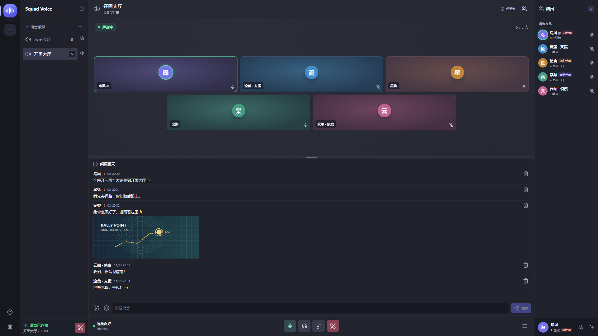
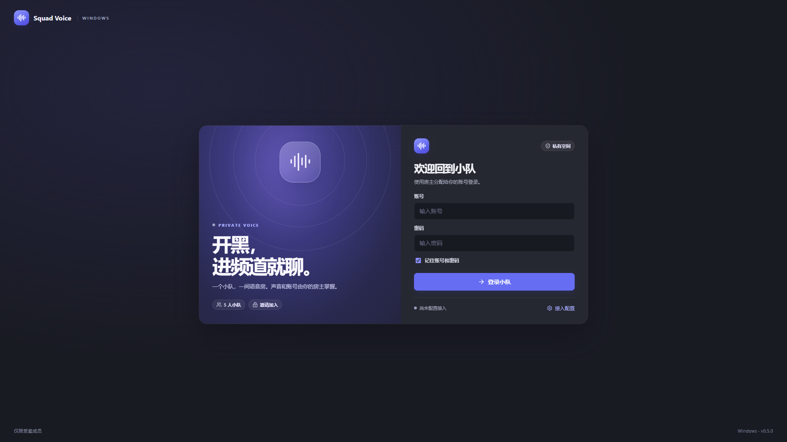
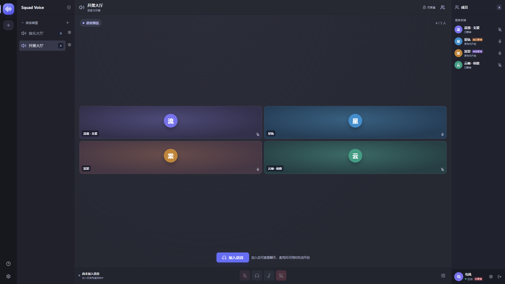
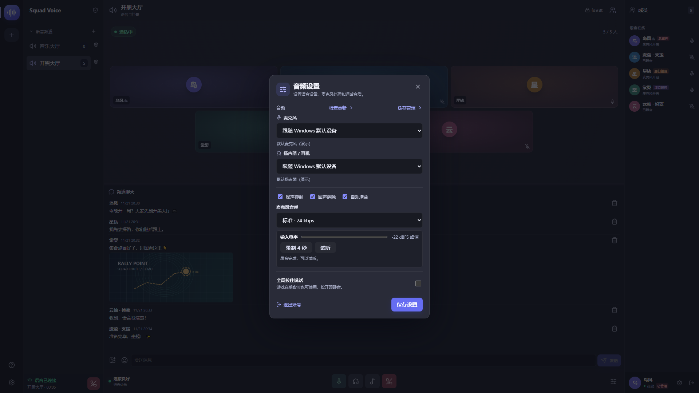
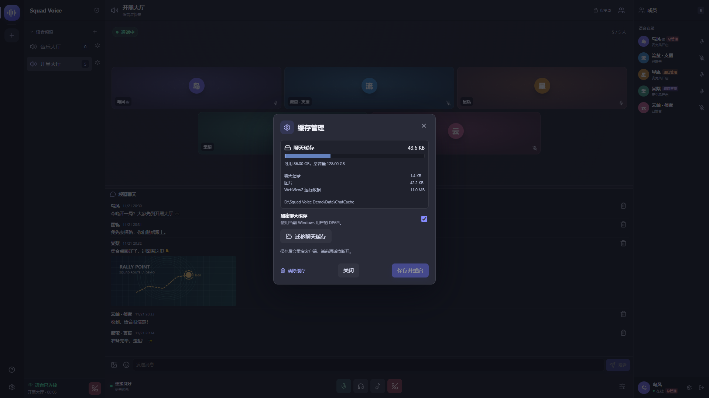
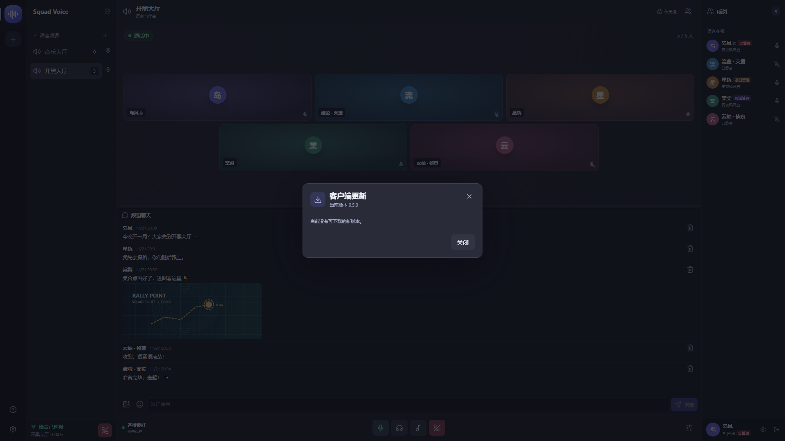

# Squad Voice

**把开黑的语音房，建在自己的服务器上。**

私有邀请 · 五人实时语音 · Windows x64 客户端 · Docker 服务端

[下载 Windows 安装包](https://github.com/GGforceP/Squad_Voice/releases/latest) · [部署服务端](#server) · [查看客户端界面](#screenshots) · [MIT 许可证](LICENSE)

---

## 🎙️ 写在前面

市面上有许多的商业语音开黑软件，但是无一例外都十分的臃肿，充斥着大量的无用功能、广告、垃圾、占内存，使用体验非常差，着重点名YY语音、KOOK，因此我自己开发了这款私有部署的语音开黑软件，UI仿Discord，尽量在保留基础功能的前提下，极致的轻量化，实测，安装包约500KB，安装后目录约60MB，内存占用约80MB。我在自己薅来的ECS服务器上部署了服务端，将客户端分发给好友一起使用，近一个月使用下来，效果非常不错，稳定性、实用性都很好，因此将其开源。

| Windows 安装包 | 安装后目录 | 运行内存 |
| :---: | :---: | :---: |
| **约 500 KB** | **约 60 MB** | **约 80 MB** |

以上是 0.5.0 的实测参考值。安装目录和内存占用会随 WebView2、缓存及使用状态变化。

Squad Voice 源码采用 MIT 许可证。你可以把服务端部署在自己的云服务器或家庭服务器，也可以 Fork 到自己的仓库，按小队的习惯增减功能。

- **客户端**运行在 Windows x64。账号由房主分配，成员填写房主提供的接入地址后登录，无需自行注册。
- **服务端**以 Docker Compose 部署。当前镜像面向 Linux x86-64（`linux/amd64`），包含账号与聊天后端、LiveKit 语音服务和 Caddy HTTPS 入口。
- **每个语音频道**最多支持五人通话。成员可以先预览频道，加入后再打开其中的聊天记录。房主可以设置接入地区，以及分配频道和管理权限。

## 🖼️ 客户端界面

### 已实现的功能

#### 客户端 · v0.5.4

1. 七档麦克风发送码率，默认 64 kbps。支持全局按住说话和单独调节队友音量。
2. 跟随 Windows 默认麦克风与扬声器，支持麦克风试听、本地 RNNoise 增强降噪、回声消除和自动增益。
3. 共享指定应用的伴奏，独立调节伴奏音量。
4. 加入前预览成员，加入后收发文字、表情和图片。
5. 记住登录信息并自动登录，关闭窗口时收至系统托盘。
6. 按需加载历史聊天。主页左下角可查看缓存用量并打开缓存管理，支持本地加密、迁移和清理。
7. 从音频设置底部检查签名更新。可立即安装并重新打开，也可后台下载，退出时自动安装。标为必需的更新仅可延后安装。

#### 服务端 · v0.5.0

1. 通过 Docker Compose 部署 HTTPS 入口、LiveKit 语音服务和应用后端。
2. 由房主管理账号，按部署时选择的地区检查客户端来源 IP。
3. 管理语音频道与三级管理员权限，支持限制成员收听、使用麦克风和发言。
4. 每个频道最多支持五人通话，并转发成员共享的伴奏。
5. 持久化文字与图片消息，按页同步历史，超出配额时优先清理最早的图片。
6. 管理员删除消息后同步给客户端，支持可选的签名安装包分发。

### 界面截图

**开黑大厅** · 五人通话与频道聊天同屏，上下分隔线可拖动。右栏显示成员头像、管理标识和麦克风状态。

<table>
  <tr>
    <td width="50%" valign="top">
      
       <strong>登录</strong> · 填写房主分配的账号，可记住登录信息。
    </td>
    <td width="50%" valign="top">
      
       <strong>频道预览</strong> · 加入前查看在线成员和语音状态。
    </td>
  </tr>
  <tr>
    <td width="50%" valign="top">
      
       <strong>音频设置</strong> · 选择设备、测试麦克风，调节音质和语音处理。
    </td>
    <td width="50%" valign="top">
      
       <strong>缓存管理</strong> · 查看磁盘用量，调整加密、迁移或清除缓存。
    </td>
  </tr>
  <tr>
    <td width="50%" valign="top">
      
    </td>
    <td width="50%" valign="middle">
      <strong>检查更新</strong> 
      在音频设置中打开检查更新。启用签名分发时，客户端从连接的服务端查询可用版本。
    </td>
  </tr>
</table>

截图使用 v0.5.0 客户端和五个演示账号。点击任一张图查看 1920 × 1080 原图。

## 💻 安装与使用 · Windows 客户端

### 安装和接入

1. 从 [GitHub Releases](https://github.com/GGforceP/Squad_Voice/releases/latest) 下载最新的 Windows x64 安装包。发布页同时提供 SHA-256 校验文件。
2. 确认 Windows 已安装 .NET Framework 4.8 和 [Microsoft Edge WebView2 Evergreen Runtime](https://developer.microsoft.com/microsoft-edge/webview2/)。
3. 打开 Squad Voice，点「接入配置」，填写房主提供的 HTTPS 地址。保存后，使用房主分配的账号和密码登录。
4. 选中语音频道可预览在线成员。点「加入语音」后即可通话和查看该频道的文字、表情及图片消息。

### 通话、聊天和本机数据

| 功能 | 使用方式 |
| --- | --- |
| 麦克风和扬声器 | 默认跟随 Windows 设备。可用麦克风会在入房时自动开启，也可以启用按住说话。音频设置提供麦克风测试、降噪、回声消除、自动增益和音质调整。 |
| 进程伴奏 | 在通话中选择一个可捕获的播放进程。队友同时听到麦克风和所选伴奏，其他应用的声音不会一起发送。 |
| 频道聊天 | 支持文字、表情和单张最大 5 MiB 的图片。双击图片查看大图，向上滚动按需加载较早记录。服务器确认本地缓存仍有效时，客户端直接读取本地记录。 |
| 成员管理 | 总管理、递归管理和频道管理使用不同颜色的标识。管理员加入房间后，可按权限通过成员右键菜单管理收听、麦克风和发言。成员等满 60 秒可以自行解除限制，管理员也可以提前解除。 |
| 登录与退出 | 记住登录后可在启动时直接进入主页面。点击窗口关闭按钮会收至通知区域，可从托盘菜单退出。 |

Windows「文档」里的 `Squad Voice` 文件夹保存安装位置、版本和偏好。安装目录中的 `Data` 保存受当前 Windows 用户 DPAPI 保护的接入资料及记住的登录信息，聊天缓存默认加密。把鼠标停在主页左下角的竖条上可查看占用，点击即可更改加密选项、迁移位置或清除本机缓存。卸载使用安装目录中的 `Uninstall.exe`。

### 从源码构建

在 Windows x64 上准备 PowerShell 7、Node.js 24、pnpm 11 和 .NET Framework 4.8。以下命令在仓库根目录运行。

~~~powershell
./scripts/Get-BuildDeps.ps1 -SkipLiveKit
./scripts/Build-Windows.ps1 -ArtifactDirectory './dist'
~~~

构建脚本会校验 WebView2 SDK 与 NSIS 等依赖，并把安装器输出到 `dist`。如需测试语音联调，使用 `Get-BuildDeps.ps1` 下载 LiveKit，再用 `Build-Windows.ps1 -QA` 生成测试构建。[发布流程](RELEASING.md) · [客户端接口](SERVER-CONTRACT.md)

## 🐳 安装与使用 · Docker 服务端

服务端适用于可对外提供 HTTPS 与 WebRTC 的 Linux x86-64 主机。`backend` 负责账号、频道和聊天，`media` 负责通话及伴奏，`edge` 负责 HTTPS、WSS 和证书续期。

### 用发布镜像启动

**1. 准备入口。** 安装 Docker Engine 和 Compose v2。使用域名时，将 DNS 记录指向可访问的入口，并保留客户端来源 IP。使用公网 IPv4 直接接入时，`SQUADVOICE_HOST` 和 `SQUADVOICE_PUBLIC_IPV4` 填同一公网地址，证书配置选 `shortlived`。家庭路由器后面的主机还需把所用端口转发到 Docker 宿主机。

| 默认入方向端口 | 用途 |
| --- | --- |
| `80/tcp` | ACME 校验与 HTTP 重定向 |
| `443/tcp` | HTTPS 接入、API 与 WSS 信令 |
| `7882/udp` | WebRTC 媒体 |
| `7881/tcp` | ICE/TCP 备用媒体通道 |

**2. 复制配置。** 克隆仓库并进入 `server`，后续命令均在此目录中运行。

~~~bash
git clone https://github.com/GGforceP/Squad_Voice.git
cd Squad_Voice/server
cp .env.example .env
~~~

用实际域名、公网 IPv4 和房主登录名替换示例值。采用域名和 0.5.0 发布镜像的配置如下。

~~~dotenv
SQUADVOICE_HOST=voice.example.invalid
SQUADVOICE_PUBLIC_IPV4=203.0.113.10
SQUADVOICE_OWNER=captain
SQUADVOICE_ACME_PROFILE=tlsserver
SQUADVOICE_IMAGE_PREFIX=ghcr.io/ggforcep/squad_voice
SQUADVOICE_IMAGE_TAG=0.5.0
cachesize=10240
ClientUdtCHK=false
~~~

**3. 初始化并启动。** 先从 [DB-IP Country Lite](https://db-ip.com/db/lite.php) 下载对应月份的 CSV gzip。初始化命令的三个参数依次为数据文件路径、数据月份和允许接入的地区代码，示例使用 `CN`。

~~~bash
docker compose -f compose.yaml -f compose.public.yaml --profile public pull
sudo sh deploy/initialize.sh /path/to/dbip-country-lite-YYYY-MM.csv.gz YYYY-MM CN
docker compose -f compose.yaml -f compose.public.yaml --profile public up -d --wait
docker compose exec backend /squadvoice admin status
~~~

**4. 分配账号。** `captain` 与 `.env` 中的总管理登录名保持一致。开户时在终端隐藏输入密码。成员收到接入地址及账号后即可登录。

~~~bash
docker compose exec backend /squadvoice admin account add captain '房主'
docker compose exec backend /squadvoice admin account add member1 '小队成员'
docker compose exec backend /squadvoice admin account list
~~~

显示名称可用中文，和登录名独立。登录名支持 3–32 位小写英文字母、数字及 `_.-`，以字母或数字开头。密码要求 9–128 位，至少包含大写字母、小写字母、数字或符号中的两类。

### 配置参考

#### 部署时填写

| 变量 | 用途 | 示例 |
| --- | --- | --- |
| `SQUADVOICE_HOST` | 对外的 DNS 名称或公网 IPv4。必填，仅填写主机名或 IP。 | `voice.example.invalid` |
| `SQUADVOICE_PUBLIC_IPV4` | WebRTC 公告给客户端的公网 IPv4。必填，NAT 部署也填公网地址。 | `203.0.113.10` |
| `SQUADVOICE_OWNER` | 容器创建时绑定总管理登录名。配置总管理时填写，并通过管理员 CLI 创建对应账号。 | `captain` |

#### 按需配置

| 变量 | 默认值或示例 | 作用 |
| --- | --- | --- |
| `SQUADVOICE_ACME_PROFILE` | 示例文件为 `tlsserver`，Compose 回退值为 `shortlived` | 给域名或公网 IPv4 选用匹配的 ACME 证书配置。 |
| `cachesize` | `10240`，单位 MiB，约 10 GiB | 服务端聊天图片的容量上限。达到上限时优先清理最早的图片，保留文字和消息记录。设为 `0` 时不接受非空图片。 |
| `ClientUdtCHK` | `false` | 设为 `true` 时启用自托管签名更新，同时加载更新挂载和发布公钥。 |
| `SQUADVOICE_IMAGE_PREFIX` | 本地构建用 `squadvoice` | 使用发布镜像时填 `ghcr.io/ggforcep/squad_voice`。 |
| `SQUADVOICE_IMAGE_TAG` | 本地构建用 `local` | 使用发布镜像时固定到版本号，例如 `0.5.0`。 |
| `SQUADVOICE_APT_MIRROR` | `deb.debian.org` | 从源码构建媒体与入口镜像时使用的 Debian 软件源。 |

<strong>构建参数、容器内部环境与时区</strong>

 

| 配置项 | 0.5.0 的作用 |
| --- | --- |
| `GO_IMAGE`、`DEBIAN_IMAGE` | Dockerfile 的基础镜像构建参数。默认固定到带摘要的 Go Alpine 和 Debian Bookworm Slim。 |
| `APT_MIRROR` | 构建参数，由 `compose.build.yaml` 将 `SQUADVOICE_APT_MIRROR` 传入。 |
| `GOMEMLIMIT` | Go 运行时内存目标。Compose 为后端传入 `200MiB`，为媒体服务传入 `360MiB`。 |
| `XDG_DATA_HOME`、`XDG_CONFIG_HOME` | 入口镜像内部使用 `/data` 和 `/tmp`，供 Caddy 存放数据与临时配置。 |
| `TZ` | 0.5.0 的默认 Compose 未传入该变量。可通过自定义 Compose 覆盖为具备时区数据的容器设置，例如 `TZ=Asia/Shanghai`。 |

#### 数据卷、文件与绑定映射

| 宿主机路径或命名卷 | 容器路径 | 内容和适用服务 |
| --- | --- | --- |
| `./config` | `/config` | 后端和媒体服务只读挂载。含按地区生成的 `geo.json` 和本机生成的媒体密钥 `keys.json`。初始化工具以可写方式挂载此目录。 |
| `accounts` | `/data` | 后端持久化数据。含 `state.json` 和 `mediacache/`，用于账号、频道、聊天数据库与图片。 |
| `sockets` | `/run/squadvoice` | 后端与 Caddy 通过 `api.sock` 通信。Caddy 侧只读挂载。 |
| `certificates` | `/data` | Caddy 的证书与续期数据，独立于后端的 `accounts` 卷。 |
| `./Client-Installer` | `/Client-Installer` | 启用更新时只读挂载。存放安装器与签名后的 `release.json`。 |
| `config/update-key.json` | `/config/update-key.json` | 自托管更新公钥，随 `./config` 进入后端。发布私钥保存在发布者的机器上。 |
| 下载的地区数据 CSV gzip | `/input.csv.gz` | 初始化命令只读挂载给工具容器。 |
| 临时文件系统 | `/tmp` | 进程临时数据。后端本机管理 socket 位于 `/tmp/squadvoice/admin.sock`。 |

需要把聊天数据单独放到宿主机目录时，可以通过附加 Compose 文件覆盖后端的绑定。聊天数据库和图片都位于该目录。宿主机目录需可供容器用户 `10001:10001` 写入，迁移已有部署时先备份并移动既有数据。

~~~yaml
services:
  backend:
    volumes:
      - ./var/mediacache:/data/mediacache
~~~

#### 启用签名更新

将 `ClientUdtCHK` 设为 `true`，给部署生成更新密钥，并用同一公钥构建配套 Windows 客户端。在 `./Client-Installer` 放入安装包和签名清单，再同时加载 `compose.updates.yaml`。

~~~bash
mkdir -p Client-Installer
docker compose -f compose.yaml -f compose.public.yaml -f compose.updates.yaml \
  --profile public up -d --wait
~~~

普通更新由用户选择下载。配置为必更时，客户端可在本次使用期间后台下载，在退出时提示确认安装。签名清单绑定版本、平台、文件大小和 SHA-256。[自托管签名更新步骤](server/README.md#签名在线更新)

### 从源码构建服务端

在 `.env` 中使用本地镜像名 `SQUADVOICE_IMAGE_PREFIX=squadvoice` 和 `SQUADVOICE_IMAGE_TAG=local`。以下命令仍在 `server` 目录运行。

~~~bash
sh deploy/fetch-deps.sh
docker compose -f compose.yaml -f compose.build.yaml --profile public build
~~~

镜像构建成功后，使用本地镜像执行前面的初始化、启动和账号分配步骤。[完整 Docker 部署文档](server/README.md) · [客户端接口约定](SERVER-CONTRACT.md) · [Dockerfile](server/Dockerfile)

## 📝 更新日志

### 0.5.4 · Windows 客户端

- 麦克风新增 48、64、80 和 96 kbps 四档。24 kbps 保留为标准档，默认选中 64 kbps。
- 麦克风通话和本机试听接入 RNNoise，压低键鼠敲击等环境声。增强降噪无法启动时会使用基础降噪。

### 0.5.3 · Windows 客户端

- 修复部分 Windows 客户端首次打开时标题栏显示为白色，窗口按钮难以看清的问题。
- 立即更新会下载安装、关闭当前客户端并自动重新打开。稍后更新会后台下载，退出时静默安装。
- 必需更新可延后至退出时安装，更新提示会保留到安装完成。

### 0.5.1 · Windows 客户端

- 「检查更新」移到音频设置底部，与「保存设置」并排。
- 主页左下角新增纵向缓存用量条。悬停查看缓存与磁盘占用，点击打开缓存管理。

### 0.5.0 · 首个公开版本

- 发布 Windows x64 安装器，以及 Linux amd64 的后端、媒体、入口三套镜像。
- 提供五人语音、频道预览、自动选择音频设备、进程伴奏和音质设置。
- 提供频道内的文字、表情与图片聊天，以及按需加载历史记录和本机加密缓存。
- 提供总管理、递归管理及频道管理，支持成员限制、频道维护和可选的签名更新。

[查看 v0.5.0 发布页](https://github.com/GGforceP/Squad_Voice/releases/tag/v0.5.0) · [所有版本](https://github.com/GGforceP/Squad_Voice/releases)

## 🌿 分支

| 分支 | 发布内容 |
| --- | --- |
| [`installer`](https://github.com/GGforceP/Squad_Voice/tree/installer) · 默认分支 | Windows x64 构建，从 GitHub Releases 发布安装器与 SHA-256。 |
| [`docker`](https://github.com/GGforceP/Squad_Voice/tree/docker) | Linux amd64 构建，从 GHCR 发布 `backend`、`media` 和 `edge` 镜像。 |

两条分支保留完整源码，根目录 `VERSION` 决定发布版本。[构建与发布流程](RELEASING.md)

## 🤝 鸣谢

- **[LiveKit](https://github.com/livekit/livekit)** 提供 WebRTC 语音服务，**[Caddy](https://github.com/caddyserver/caddy)** 提供 HTTPS 入口与证书管理。
- **RNNoise** 和 **Web Audio 降噪封装**用于客户端本地增强降噪。[RNNoise](https://github.com/xiph/rnnoise) · [Web Audio 降噪封装](https://github.com/sapphi-red/web-noise-suppressor)
- **[Microsoft WebView2](https://developer.microsoft.com/microsoft-edge/webview2/)** 承载 Windows 客户端界面，**[NSIS](https://nsis.sourceforge.io/)** 用于打包安装器。
- **[React](https://react.dev/)**、**[Vite](https://vite.dev/)** 和 **[Lucide](https://lucide.dev/)** 提供界面、构建工具和图标。
- **[DB-IP Country Lite](https://db-ip.com/db/lite.php)** 提供可选用的地区数据。

各组件按各自的许可分发。[第三方组件与许可](THIRD_PARTY.md)

---

Powered by Codex

